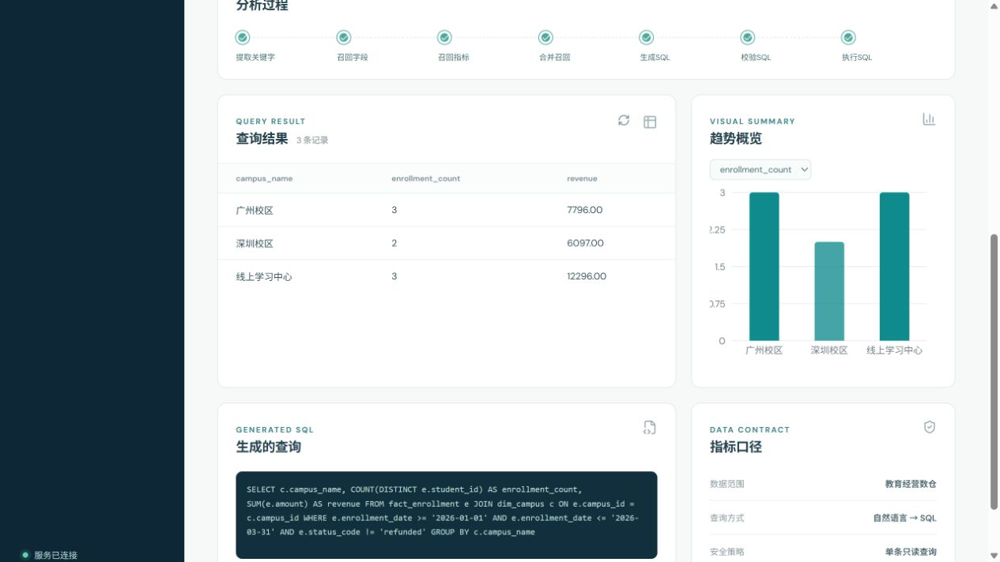
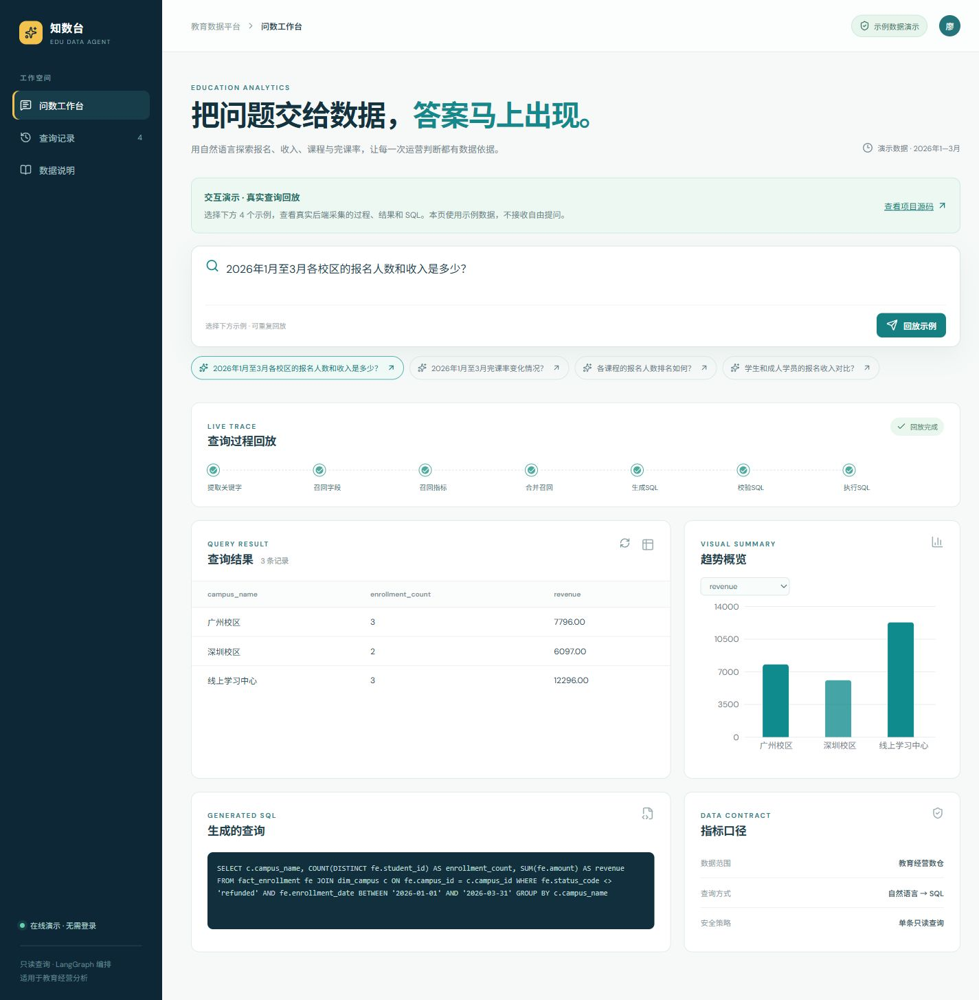
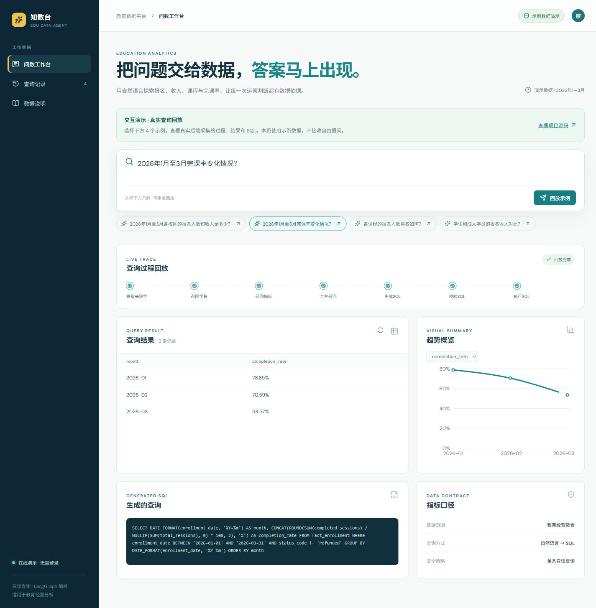

# 教育数据智能问数 Agent

面向教育培训场景的自然语言问数系统。用户可以直接提问报名人数、收入、完课率、课程和校区等经营问题，系统通过 LangGraph 编排检索、SQL 生成、只读校验和执行，并在工作台中实时展示处理过程、结果表格、图表和 SQL。

**[打开免登录交互演示](https://2nott.github.io/data-agent/)** · [GitHub 源码](https://github.com/2NOTT/data-agent)

在线版可点击 4 个示例，回放真实后端采集的处理状态、查询结果和 SQL，支持切换图表指标、查看查询记录和数据说明。由 GitHub Pages 托管，不依赖开发者电脑开机。

> 在线版是**真实查询记录的交互回放**，不是在线大模型服务；不支持任意提问。记录采集于 2026-10-17，使用仓库附带的教育示例数据，不含真实学员信息。完整自由问数需按下文启动本地后端并配置模型。

## 实操截图

本地完整应用：自然语言提问后，展示实际执行结果、图表和只读 SQL。



免登录演示：校区收入对比，可切换报名人数与收入指标。



完课率趋势：按报名月份统计已完成课次 / 总课次，排除退款记录。



## 项目定位与验证范围

这是基于课程材料整理和完善的教育场景学习项目，包含本地运行修复、指标依赖约束、前端结果展示、自动化检查和公开演示部署。示例规模为 4 张业务表、12 条报名记录；不将示例效果当作生产规模验证或商业落地成果。

2026-10-17 本地验证：12 项后端单元检查、3 项前端检查、2 项真实模型问数检查通过；4 份公开记录的 SQL 已在 MySQL 重新执行并与录制结果逐项比对。构建同时覆盖本地完整应用和静态演示。模型生成存在不确定性，任意业务提问仍需核对筛选条件和指标口径；只读校验不等于语义正确性。

## 静态演示与部署

```powershell
npm ci
npm run test:frontend
npm run build:demo
npm run preview:demo
```

打开终端显示的地址并访问 `/data-agent/`。演示记录位于 `frontend/src/demo-queries.json`，正式应用仍通过 `npm run build` 构建。GitHub Pages 从 `gh-pages` 分支的根目录发布 `frontend/demo-dist` 构建产物；更新 `master` 源码后需重新构建并更新该发布分支。静态站点不包含模型密钥，也不连接本地 API、数据库或向量服务。

## 项目亮点

- **自然语言问数**：将教育业务问题转换为可执行的 MySQL 查询。
- **三路元数据召回**：使用 Qdrant 召回字段和指标，使用 Elasticsearch 召回业务枚举值。
- **可追溯 Agent 流程**：关键词提取、字段/指标/值召回、元数据合并、SQL 生成、校验、修正和执行均通过 SSE 返回状态。
- **只读安全执行**：SQL 执行前检查单条语句、查询类型和危险操作，拒绝写入、删除和结构变更操作。
- **可演示前端**：React + Vite 问数工作台，支持示例问题、实时进度、结果表格、趋势图、SQL 展示和查询记录。

## 技术栈

后端：Python 3.12、FastAPI、LangGraph、LangChain、MySQL、Qdrant、Elasticsearch、SSE、Docker。

前端：React、Vite、Recharts、Lucide React。

模型：支持 SiliconFlow 或其他 OpenAI 兼容接口。密钥只从环境变量读取，不写入代码和 Git。

## 系统流程

```text
自然语言问题
    -> 关键词提取
    -> 字段 / 指标 / 枚举值召回
    -> 元数据合并与过滤
    -> SQL 生成
    -> 只读校验与错误修正
    -> MySQL 执行
    -> 表格与图表结果
```

## 目录结构

```text
app/                    后端 Agent、API、客户端、仓储和服务
conf/                   应用配置和元数据配置
docker/                 MySQL、ES、Qdrant 等依赖配置
frontend/               React/Vite 前端源码
tests/                  后端单元测试
main.py                 FastAPI 生产入口
```

## 环境变量

项目支持两种命名方式。推荐直接使用已有的通用变量：

```text
API_KEY=你的模型密钥
BASE_URL=https://api.siliconflow.cn/v1
MODEL=deepseek-ai/DeepSeek-V4-Flash
```

也支持：

```text
SILICONFLOW_API_KEY=你的模型密钥
SILICONFLOW_BASE_URL=https://api.siliconflow.cn/v1
SILICONFLOW_MODEL=deepseek-ai/DeepSeek-V4-Flash
```

不要把真实密钥写入 `README.md`、源代码、截图或 Git 提交。`.env` 文件已被 Git 忽略。

## 启动方式

### 0. 克隆项目

项目包含用于本地 Embedding 服务的模型文件，模型通过 Git LFS 管理。第一次克隆前请安装并启用 Git LFS：

```powershell
git lfs install
git clone https://github.com/2NOTT/data-agent.git
cd data-agent
git lfs pull
```

Embedding 模型约 1.3GB，首次拉取需要一定时间和磁盘空间。未安装 Git LFS 时，模型文件只是指针文件，Embedding 容器无法启动。

运行环境要求：Windows 10/11 或 Linux、Python 3.12、Node.js 20.19+（22.x 需 22.12+）、npm、Docker Desktop，以及至少 6GB 可用内存。

### 1. 安装 Python 依赖

推荐使用 `uv`，它会根据 `uv.lock` 安装固定版本：

```powershell
python -m pip install uv
uv sync
```

如果不使用 `uv`，也可以创建虚拟环境后安装项目依赖：

```powershell
python -m venv .venv
.\.venv\Scripts\Activate.ps1
python -m pip install --upgrade pip
python -m pip install -e .
```

### 2. 配置模型环境变量

PowerShell 临时配置示例：

```powershell
$env:API_KEY = "你的模型密钥"
$env:BASE_URL = "https://api.siliconflow.cn/v1"
$env:MODEL = "deepseek-ai/DeepSeek-V4-Flash"
```

也可以复制 `.env.example` 为项目根目录的 `.env` 并填写密钥，或在 PyCharm 的 `Run/Debug Configurations -> Environment variables` 中配置同名变量。程序会自动加载 `.env`，已有环境变量优先；密钥不要提交到 Git。

### 3. 启动基础设施

已有安装升级时，先运行 `docker compose ls` 确认原项目名，再设置 `$env:COMPOSE_PROJECT_NAME = "原项目名"`，后续 Compose 命令和 `start.ps1` 就会继续使用该项目原有的数据卷。原配置在本目录通常使用 `docker` 项目名；不要为了切换项目名执行 `down -v`，否则会删除旧数据。

```powershell
docker compose -f docker/docker-compose.yaml up -d
```

确认 MySQL、Elasticsearch、Qdrant 和 Embedding 服务就绪。它们使用独立的 `data-agent` Compose 项目和数据卷，端口仅绑定本机。Kibana 为可选工具，可通过 `docker compose -f docker/docker-compose.yaml --profile tools up -d kibana` 启动。

### 4. 初始化元数据

```powershell
.\.venv\Scripts\python.exe -m app.scripts.build_meta_knowledge
```

必须使用模块方式运行，避免 Python 找不到 `app` 包。此脚本用于首次构建：已有元数据时不要直接重复运行，原课程实现会重建向量/全文索引且 MySQL 可能出现主键冲突。

### 5. 构建前端

首次运行或修改前端代码后执行：

```powershell
npm install
npm run build
```

构建产物位于 `frontend/dist`，由 FastAPI 自动托管。

### 6. 启动完整应用

Windows 可运行：

```powershell
.\start.ps1
```

它会启动本项目基础设施，并补充当前进程尚未继承的 Windows 用户模型环境变量，然后启动后端。也可以在 PyCharm 中直接运行项目根目录的 `main.py`。打开 `http://localhost:8000`。

接口文档：`http://localhost:8000/docs`

只调试前端时可以执行：

```powershell
npm run dev
```

保持后端在 `8000` 端口运行，再访问 Vite 显示的地址。开发服务器会将 `/api` 和 `/health` 转发到后端。

### 数据库初始化说明

首次启动 MySQL 时，Docker 会自动执行 `docker/mysql` 下的初始化 SQL，其中 `education.sql` 创建 `dw_edu` 教育示例库，包含 4 张表和 2026 年 1 至 3 月的少量演示记录，不代表真实业务数据。已有同名数据卷时，初始化脚本不会重复执行；如果需要重新初始化演示数据，请确认不需要保留数据后执行：

```powershell
docker compose -f docker/docker-compose.yaml down -v
docker compose -f docker/docker-compose.yaml up -d
```

这个操作会删除该 Compose 项目的本地数据库卷。

## 推荐演示问题

当前演示数据时间范围为 2026 年 1 月至 3 月，推荐使用：

- 2026 年 1 月至 3 月各校区的报名人数和收入是多少？
- 2026 年 1 月至 3 月完课率变化情况？
- 各课程的报名人数排名如何？
- 学生和成人学员的报名收入对比？

## API 示例

```powershell
curl.exe -N -X POST http://localhost:8000/api/query `
  -H "Content-Type: application/json" `
  -d '{"query":"各课程的报名人数排名如何？"}'
```

接口以 `text/event-stream` 返回 `progress`、`result`、`done` 和 `error` 事件。

## 验证

```powershell
.\.venv\Scripts\python.exe -m unittest discover -s tests -v
.\.venv\Scripts\python.exe -m compileall -q app main.py
npm run test:frontend
npm run build
npm run build:demo
```

系统只允许执行单条只读 SQL。没有配置模型密钥时，健康检查和文档页面仍可启动，但实际问数会返回配置错误。

服务运行且使用附带的教育示例数据时，可执行真实问数回归检查（会调用已配置的模型接口）：

```powershell
$env:DATA_AGENT_TEST_URL = "http://127.0.0.1:8000"
.\.venv\Scripts\python.exe -m unittest discover -s tests -p test_live_query.py -v
Remove-Item Env:DATA_AGENT_TEST_URL
```
